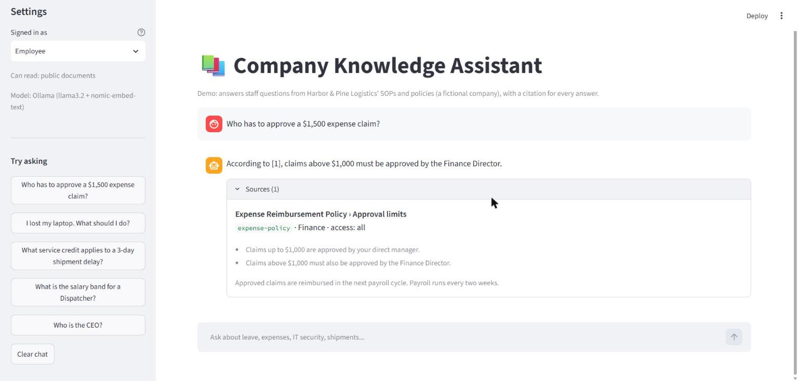
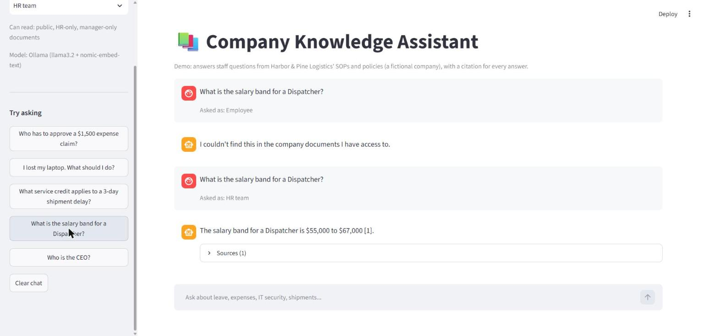

# Enterprise RAG Knowledge Assistant (demo)

An AI assistant that answers staff questions from company SOPs and policies, cites the passage behind every answer, respects document permissions, and says so when the answer isn't in the documents.

It runs fully locally on Ollama (no data leaves the machine) or on Azure OpenAI by changing one setting.

> **Demo data:** Harbor & Pine Logistics is a fictional company. The 11 documents in `data/docs` were written for this demo.



## What it does

- **Answers with citations.** Every answer references the numbered passage it came from, and the UI shows the source document and section.
- **Hybrid retrieval.** Combines BM25 keyword search (good for codes, amounts and names like `D4` or `SecureLink`) with vector search (good for paraphrased questions), merged with reciprocal rank fusion.
- **Role-based access.** Documents are tagged `all`, `manager` or `hr`. Restricted chunks are filtered out *before* retrieval, so the model never sees content the user isn't allowed to read.
- **"I don't know" instead of guessing.** If no passage is relevant enough, the assistant answers "not found" without calling the LLM, and the prompt tells the model to refuse when the context doesn't contain the answer.
- **Measured, not assumed.** A 36-question evaluation set checks retrieval, answer accuracy, citations, refusals and data leaks.



*The same question asked as an Employee (refused: salary bands are HR-only) and as HR (answered with a citation).*

## Architecture

```
Markdown docs (front matter: title, department, access)
        │  chunk by section, keep title + heading in each chunk
        ▼
Embeddings (nomic-embed-text on Ollama, or Azure OpenAI)  ──► data/index/
        │
Question + user role
        │  1. filter chunks by role
        │  2. BM25 top 10  +  vector top 10
        │  3. reciprocal rank fusion → top 4
        │  4. similarity below threshold? → "not found"
        ▼
LLM (llama3.2 on Ollama, or Azure OpenAI) with numbered context
        │  must cite [n]; replies NOT_FOUND if context doesn't answer
        ▼
Answer + cited sources  →  Streamlit chat UI
```

| Layer | Choice |
|---|---|
| Retrieval | Custom BM25 + cosine similarity (NumPy) with reciprocal rank fusion |
| Embeddings | `nomic-embed-text` (Ollama) or an Azure OpenAI embedding deployment |
| LLM | `llama3.2` 3B (Ollama) or an Azure OpenAI chat deployment |
| UI | Streamlit |
| Tests | pytest unit tests for chunking, BM25, fusion and access control |

## Evaluation

`python -m eval.run_eval` runs 36 questions (29 answerable, 3 permission-restricted, 4 out of scope) and writes [`eval/results.md`](eval/results.md).

Latest run on a local `llama3.2` 3B model:

| Metric | Result |
|---|---|
| Retrieval hit rate (correct document in top 4) | 100% (29/29) |
| Answer accuracy (all expected facts present) | 97% (28/29) |
| Answers with inline citations | 83% (24/29) |
| Correct "not found" on restricted or out-of-scope questions | 100% (7/7) |
| Restricted data leaks | 0 |

**Known limitations**

- The local 3B model sometimes leaves out the inline `[n]` citation; the UI then shows the top-ranked source. A larger model (for example via Azure OpenAI) is the obvious upgrade.
- One answerable question in the set ("Which VPN should I use on hotel Wi-Fi?") is wrongly refused even though retrieval finds the right passage.
- Expected answers are checked by keyword match, which is strict but not a substitute for human review.

## Run it

Requires Python 3.11+ and [Ollama](https://ollama.com).

```bash
ollama pull llama3.2
ollama pull nomic-embed-text

python -m venv .venv
.venv\Scripts\activate          # macOS/Linux: source .venv/bin/activate
pip install -r requirements.txt

python -m rag.ingest            # build the index
streamlit run app.py            # open http://localhost:8501
python -m eval.run_eval         # optional: run the evaluation
pytest                          # unit tests
```

### Use Azure OpenAI instead

Copy `.env.example` to `.env`, set `RAG_PROVIDER=azure` and fill in your endpoint, key and deployment names, then rebuild the index with `python -m rag.ingest`. The Azure path is implemented but was not part of the evaluation run above.

## Project layout

```
app.py              Streamlit chat UI
rag/config.py       settings and role → access mapping
rag/documents.py    front matter parsing and section chunking
rag/retrieval.py    BM25, vector search, reciprocal rank fusion, access filter
rag/providers.py    Ollama and Azure OpenAI providers
rag/assistant.py    index build, retrieval, prompting, citation handling
eval/               evaluation questions, runner and results
tests/              unit tests
data/docs/          fictional company documents
```
